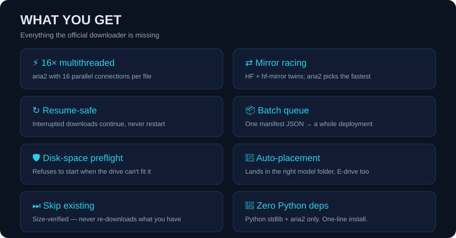

<p align="center">
  
</p>

<h1 align="center">⚡ ComfyUI Accelerated Downloader</h1>

<p align="center">
  <b>Turn a 30-minute model download into a 2-minute one.</b><br>
  Deploying ComfyUI means pulling down <b>hundreds of GB</b> of models — and the
  official downloader is painfully slow. This accelerator fixes that.
</p>

<p align="center">
  
  
  
  
  
</p>

> 中文簡介：ComfyUI 部署需要下載大量模型檔，官方下載速度極慢，作者因此開發了這個加速器——aria2 16 路並發、雙鏡像競速、斷點續傳、批量下載、磁碟預檢與自動歸位，直接嵌入 ComfyUI。

---

## 🚀 Install

```powershell
.\install.ps1                  # auto-detects D:\ComfyUI, installs aria2 if missing
.\install.ps1 -Root <path>     # or point it at your ComfyUI root
# restart ComfyUI
```

## 📊 Why it's fast


- **16× multithreading** via aria2
- **Mirror racing** — every HF URL also gets an `hf-mirror.com` twin, aria2 uses the faster one
- **Resume-safe** (`-c`) + **size-verified skip** of existing files

## ✨ What you get



## 🧭 Usage

**As a node** — search 「加速模型下載」 (category `utils/下載加速`), feed it a manifest JSON path, done. Disk preflight runs first.

**As an API** — async & pollable:

| Endpoint | Purpose |
|---|---|
| `POST /api/accelerated-download/check` | preflight: per-drive need / free GB |
| `POST /api/accelerated-download/start` | start a batch → `task_id` |
| `GET  /api/accelerated-download/status?task_id=...` | poll progress |

**Manifest format**

```json
{ "files": [ { "name": "sd_xl_base_1.0.safetensors",
               "url": "https://huggingface.co/stabilityai/stable-diffusion-xl-base-1.0/resolve/main/sd_xl_base_1.0.safetensors",
               "directory": "checkpoints", "size_gb": 6.46 } ] }
```

`directory` = subfolder under `models/`. Also compatible with `comfyui_template_analysis.json`.

## 💬 FAQ

<details>
<summary>Does it work for non-HuggingFace URLs?</summary>
Yes — multithreading and resume still apply; only mirror racing is HF-specific.
</details>

<details>
<summary>Can it download gated / signed URLs?</summary>
No — aria2 can't authenticate. Resolve a valid direct URL first.
</details>

<details>
<summary>Requirements?</summary>
aria2 only (auto-installed), Windows PowerShell, ComfyUI.
</details>

## 📄 License

MIT
